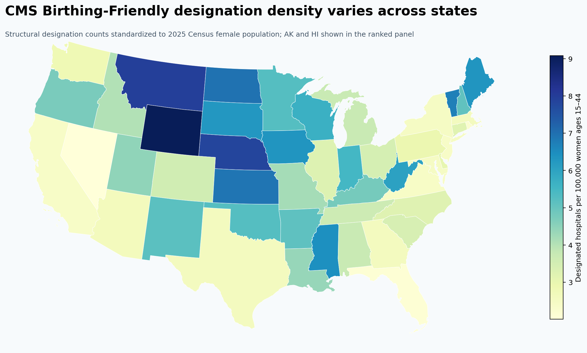
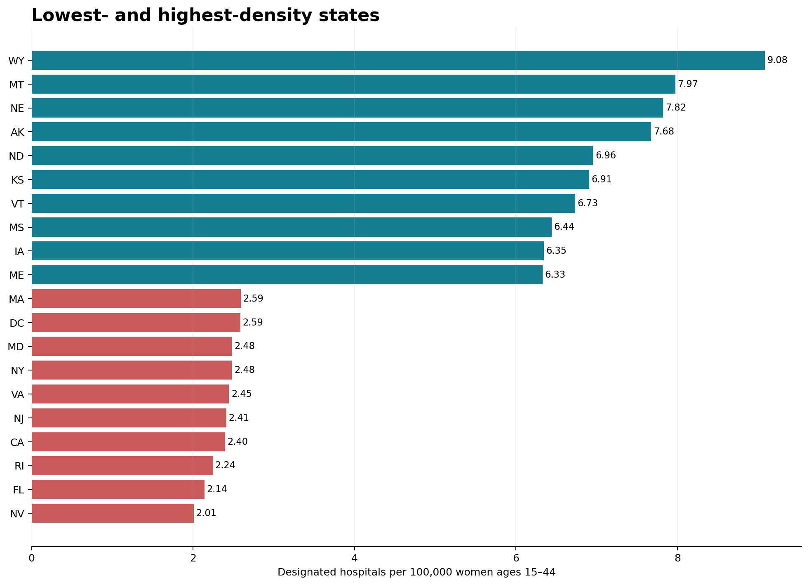

# Mapping CMS Birthing-Friendly Hospital Designation Density



## Executive summary

This project asks a practical maternal-health planning question: **where is the CMS Birthing-Friendly designation most sparse relative to the population of women ages 15–44?** It joins the July 2026 CMS Hospital General Information release to the Census Bureau's 2025 state age/sex estimates, standardizes counts, quantifies uncertainty, and creates a QGIS-ready layer.

Across the 50 states and Washington, D.C., **2,256 hospitals** carried the designation, or **3.33 per 100,000 women ages 15–44**. State rates ranged from **2.01 in Nevada** to **9.08 in Wyoming**; the state median was **3.74**. Critical Access Hospitals represented **215 (9.5%)** designated facilities, and states with a larger Critical Access Hospital share tended to have higher designation density (Spearman rho **0.70**, p < 0.001).

These findings are a **screening signal**, not a hospital ranking or proof of geographic access. The designation is based on a CMS structural measure, the denominator is population rather than births, and state averages cannot measure travel time or clinical outcomes.

## Decision use case

- **Audience:** maternal-health program leaders, health plans, quality-improvement collaboratives, and healthcare analysts.
- **Use:** identify states for closer county-level access review, validate the role of Critical Access Hospitals, and prioritize follow-up with service-area and birth-volume data.
- **Do not use:** to select a hospital for an individual patient, compare clinical safety, or infer that an undesignated hospital offers no labor and delivery services.

## Key findings

| Finding | Result |
|---|---:|
| Designated hospitals, 50 states + D.C. | 2,256 |
| Designated hospitals in all CMS rows | 2,263 |
| Puerto Rico facilities reported separately | 7 |
| National density | 3.33 per 100,000 women ages 15–44 |
| Median state density | 3.74 |
| Lowest / highest state density | Nevada 2.01 / Wyoming 9.08 |
| Designated Critical Access Hospitals | 215 (9.5%) |
| Density vs. Critical Access Hospital share | Spearman rho 0.70; p < 0.001 |



## Tools demonstrated

- **DuckDB SQL:** typed cleaning, designation flag, deduplication checks, state aggregation
- **Python:** reproducible pipeline, exact Poisson confidence intervals, Spearman analysis, automated QA
- **GeoPandas / QGIS:** state spatial join, choropleth, portable GeoJSON
- **Data governance:** checksums, source manifest, explicit inclusion rules, limitations and ethical-use notes

## Repository structure

```text
data/raw/                 Frozen public-source snapshots
data/processed/           Analytic hospital extract
docs/                     Methods, dictionary, ethics, references
outputs/figures/          Portfolio-ready PNGs
outputs/tables/           State results, QA manifest, key results
qgis/                     QGIS-ready GeoJSON and styling notes
sql/                      DuckDB transformation SQL
src/                      Acquisition, analysis, QA, mapping
tests/                    Output reconciliation tests
```

## Reproduce the analysis

```bash
python -m venv .venv
# Windows: .venv\Scripts\activate
# macOS/Linux: source .venv/bin/activate
python -m pip install -r requirements.txt
python src/analyze.py
python -m pytest -q
```

The repository includes the exact public-source snapshots used. If a raw file is absent, the pipeline attempts to retrieve it from the documented official URL. CMS distribution URLs can change after a catalog refresh; if that happens, download the current file from the [CMS dataset page](https://data.cms.gov/provider-data/dataset/xubh-q36u) and update the manifest.

## Interpretation guardrails

CMS describes Birthing-Friendly as a structural designation for hospitals or systems that reported participation in a perinatal quality-improvement collaborative and implementation of evidence-based quality interventions. It is not a composite safety score. A state with more designations per population may still contain local maternity-care gaps; a low-density state may have large delivery centers that serve many patients.

See [Methods](docs/METHODS.md), [Data dictionary](docs/DATA_DICTIONARY.md), [Ethics and limitations](docs/ETHICS_AND_LIMITATIONS.md), and [References](docs/REFERENCES.md).

## Author

**Kira Gor, BDS, MPH**  
Epidemiology and healthcare analytics portfolio  
[Portfolio](https://gorkira28.github.io/) · [LinkedIn](https://www.linkedin.com/in/dr-kira-gor/)

## License and citation

Code is available under the [MIT License](LICENSE). Source data remain subject to their agencies' terms and public-domain notices. Cite this project using [CITATION.cff](CITATION.cff).

